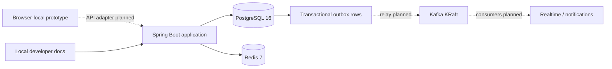
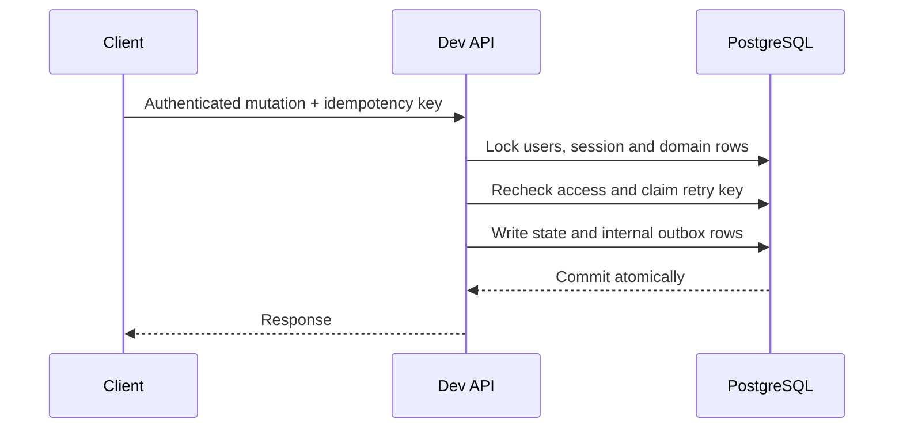

# Architecture

P2Picks is being built as a modular monolith. PostgreSQL is authoritative;
Redis is disposable, and Kafka is intended for committed events rather than
financial truth.

Solid lines describe existing infrastructure or direct reads/writes; dotted
lines show planned integrations. The outbox is storage only: there is no relay,
consumer, or delivery guarantee yet.

## Code boundaries

The `app` project owns the current dev HTTP controllers, services, security and
support code. Eleven Gradle domain modules have named `api` interfaces and
private `internal` packages; most remain skeletons. The bets and settlement
modules provide pure calculators, not transactional domain services. The shared
kernel contains exact integer-cent money.

Spring Modulith and ArchUnit tests check module discovery and dependencies.
Organizational subdirectories inside `app` are not separate Java packages.

## Transaction pattern

Selected mutations implement this pattern; it is not universal. Retry records
are not pruned and key rotation/recovery are unresolved. Future debt-affecting
writers must acquire affected user rows in PostgreSQL UUID order before table,
bet, ledger, or receipt locks. See the <a href="/docs/source/reference/domain-rules.md" download>domain rules</a>
for operation-specific invariants.

## Runtime and trust boundaries

Only the dev profile is accepted today. The backend defaults to loopback; the
Compose service publishes on loopback. LAN and production remain blocked until
their security and deployment designs exist. The docs are unauthenticated whenever dev is active. The default binding and
Compose port are local, but exposing a dev server to a network also exposes
its documentation. This is not a production documentation-access policy.

The [accepted ADRs](/reference) describe intended boundaries and unresolved
outbox/feed decisions.
