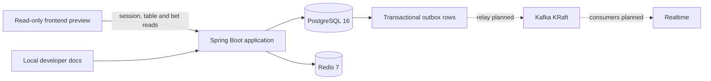
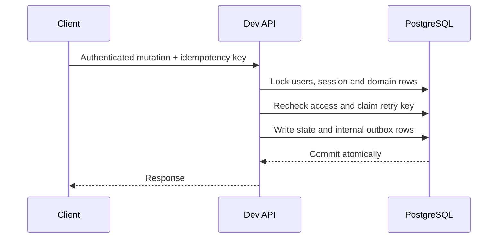

# Architecture

P2Picks is being built as a modular monolith. PostgreSQL is authoritative;
Redis is disposable, and Kafka is intended for committed events rather than
financial truth.

Solid lines describe existing infrastructure or direct reads/writes; dotted
lines show planned integrations. The outbox is storage only: there is no relay,
consumer, or delivery guarantee yet.

## Code boundaries

The `app` project owns the dev HTTP controllers, services and security, in one
Java package per feature: `users`, `social`, `tables`, `chat`, `bets`,
`settlement`, `feedback` and `admin`, plus `security`, `config` and `common`
(retry protection, error responses and text validation). Classes stay
package-private unless another feature uses them.

Two Gradle domain modules, `bets` and `settlement`, expose pure payout,
settler, debt and table-settlement calculators through named `api` packages;
they are not transactional services. Folders for other planned modules are
reserved but not built. The shared kernel contains exact integer-cent money.

Only `@ApplicationModule` packages are Spring Modulith modules. Modulith and
ArchUnit tests check module discovery, cycles and API-only access, and that
modules and the kernel never depend on `app`.
The dev HTTP filter checks the current account role: admin accounts cannot call
player APIs, and players cannot call admin APIs. Both can use session endpoints;
public dev docs and health remain available. No account-role change API exists.
Migration V24 rejects ordinary role updates; privileged database operators can
bypass the guard. The request-level boundary alone does not stop an in-flight
request after an out-of-band role change.

## Shared betting and mode boundaries

U2Pick and sports bets share table authorization, pick privacy, debt-cap
checks, locking, remainder snapshots, payout, ledger and points settlement.
The payout and table-settlement calculators are exposed through their modules'
named APIs so both paths can use the same cent-safe rules. They do not perform
authorization, database writes or event delivery.

Keep mode-specific proposal validation and result authority separate: U2Pick
uses a custom question and choices and an eligible member calls its outcome;
sports modes require validated game data and resolve only from the feed.
Feed freshness, baselines, overtime and chronology must not be inferred from a
U2Pick result, and a member-called result must never authorize a sports bet.
U2Pick transactions and shared points settlement exist internally, with HTTP
adapters gated for tests only. The sports feed remains planned.

## Transaction pattern

Selected mutations implement this pattern; it is not universal. Retry records
are not pruned and key rotation/recovery are unresolved. Future debt-affecting
writers must acquire affected user rows in PostgreSQL UUID order before table,
bet, ledger, or receipt locks. See the <a href="/docs/source/reference/domain-rules.md" download>domain rules</a>
for operation-specific invariants.

## Runtime and trust boundaries

Only the dev profile is accepted today. The backend defaults to loopback; the
Compose service publishes on loopback. LAN and production remain blocked until
their security and deployment designs exist. The docs are unauthenticated whenever dev is active. The default binding and
Compose port are local, but exposing a dev server to a network also exposes
its documentation. This is not a production documentation-access policy.

The [accepted ADRs](/reference) describe intended boundaries and unresolved
outbox/feed decisions.
