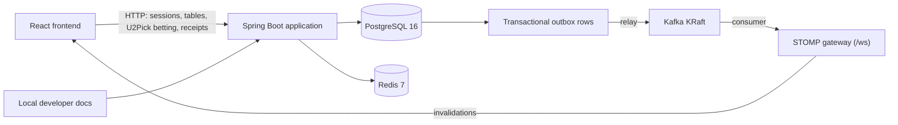
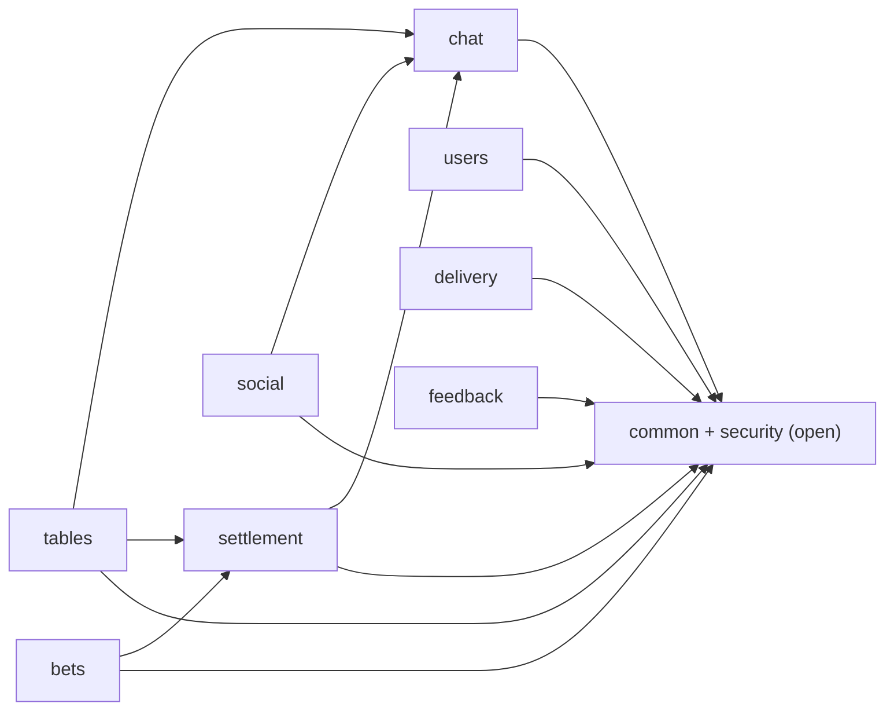
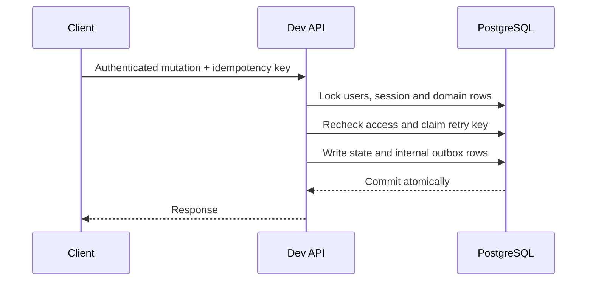

# Architecture

P2Picks is being built as a modular monolith. PostgreSQL is authoritative;
Redis is disposable, and Kafka is intended for committed events rather than
financial truth.

The `delivery` module's relay publishes committed outbox rows to Kafka at
least once; its consumer turns bet, chat and settlement events into
invalidations that the WebSocket gateway sends to authorized subscribers. The
<a href="/docs/source/reference/realtime-contract.md" download>realtime contract</a> describes
destinations, authorization and recovery. Redis is not used for delivery yet.

## Modules and data ownership

The backend is one Spring Boot application, `backend/app`. Each package under
`com.p2picks.app` is a Spring Modulith module. A module's public types are its
API and everything else is package-private. Each `package-info.java` declares
the module's allowed dependencies, and the architecture tests reject cycles,
undeclared dependencies and calculators that use Spring or JDBC.

| Module | Owns (writes) these tables |
|---|---|
| `security` | `auth_sessions` |
| `users` | `users` (profile fields) |
| `social` | `follows`, `blocks`, `invite_preferences`, `table_invites` (responses) |
| `tables` | `tables`, `table_members`, `table_archive_members`, `quickpick_subscriptions`, `table_invites` (creation) |
| `chat` | `chat_messages` (other modules use `ChatMessageWriter`), `reactions`, `chat_read_positions` |
| `bets` | `bets`, `bet_participants`, `picks`, `ledger_entries` |
| `settlement` | `settlements`, `settlement_lines`, `settlement_bets`, `settlement_pair_reviews`, `debt_caps` |
| `feedback`, `admin` | `feedback`; `admin_user_flags` (storage only) |
| `common` | `http_idempotency`, `http_idempotency_key_guard`, `processed_events`, `outbox` (modules call `Outbox.append`) |
| `delivery` | `outbox.published_at` only; reads sessions, memberships and receipt parties to authorize realtime delivery |

Every event type is listed in `common.OutboxEvent`; `common.Outbox` is the only
writer of the outbox, and `chat.ChatMessageWriter` is the only way other modules
add chat messages. A source-scan test enforces both.

Reads are not yet divided: many queries read or lock other modules' tables
inside one transaction (for example, `users` joins settlements and chat, and
`tables` and `social` both write `table_invites`). This keeps lock order and
checks atomic. Before a module is extracted, replace those joins with calls to
the owning module and revisit the transaction boundaries.

The shared kernel is a plain Java library containing exact integer-cent money.

The dev HTTP filter checks the current account role: admin accounts cannot call
player APIs, and players cannot call admin APIs. Both can use session endpoints;
public dev docs and health remain available. No account-role change API exists.
Migration V24 rejects ordinary role updates; privileged database operators can
bypass the guard. The request-level boundary alone does not stop an in-flight
request after an out-of-band role change.

## Shared betting and mode boundaries

U2Pick and sports bets share table authorization, pick privacy, debt-cap
checks, locking, remainder snapshots, payout, ledger and points settlement.
The payout and table-settlement calculators are exposed through their modules'
named APIs so both paths can use the same cent-safe rules. They do not perform
authorization, database writes or event delivery.

Keep mode-specific proposal validation and result authority separate: U2Pick
uses a custom question and choices and an eligible member calls its outcome;
sports modes require validated game data and resolve only from the feed.
Feed freshness, baselines, overtime and chronology must not be inferred from a
U2Pick result, and a member-called result must never authorize a sports bet.
U2Pick transactions and shared points settlement are exposed over HTTP. The
sports feed remains planned.

## Transaction pattern

Selected mutations implement this pattern; it is not universal. Retry records
are not pruned and key rotation/recovery are unresolved. Future debt-affecting
writers must acquire affected user rows in PostgreSQL UUID order before table,
bet, ledger, or receipt locks. See the <a href="/docs/source/reference/domain-rules.md" download>domain rules</a>
for operation-specific invariants.

## Runtime and trust boundaries

Only the dev profile is accepted today. The backend defaults to loopback; the
Compose service publishes on loopback. LAN and production remain blocked until
their security and deployment designs exist. The docs are unauthenticated whenever dev is active. The default binding and
Compose port are local, but exposing a dev server to a network also exposes
its documentation. This is not a production documentation-access policy.

The [accepted ADRs](/reference) describe intended boundaries and unresolved
outbox/feed decisions.
