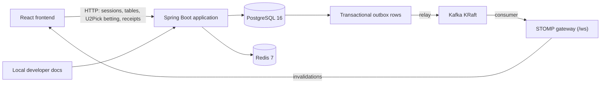
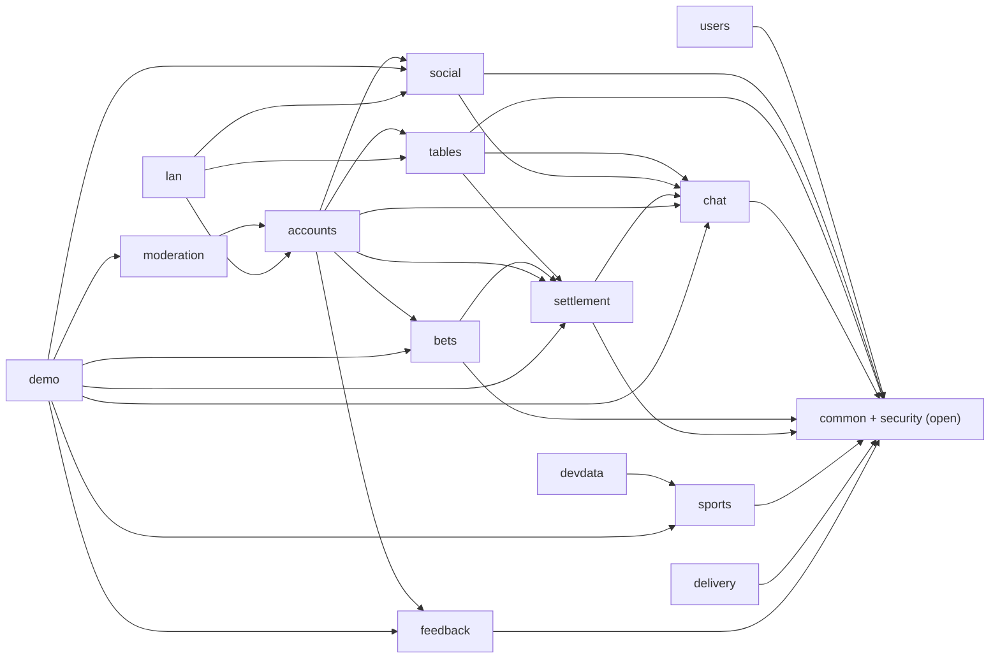
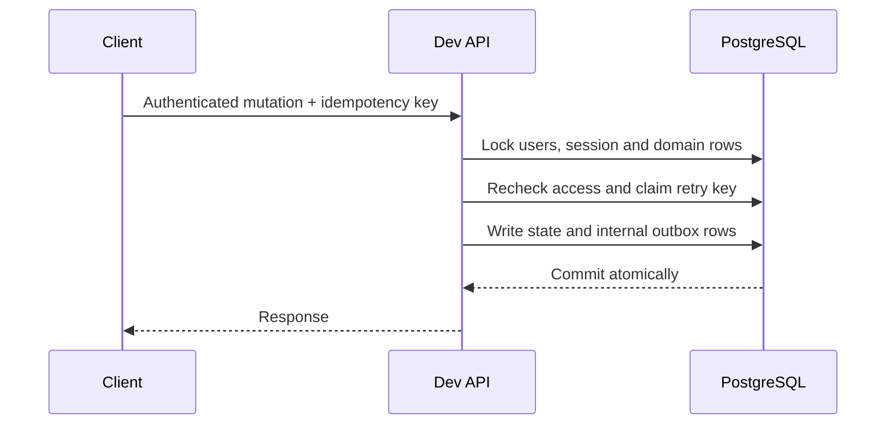

# Architecture

P2Picks is being built as a modular monolith. PostgreSQL is authoritative;
Redis is disposable, and Kafka is intended for committed events rather than
financial truth.

The `delivery` module's relay publishes committed outbox rows to Kafka at
least once; its consumer turns bet, chat and settlement events into
invalidations that the WebSocket gateway sends to authorized subscribers. The
[realtime contract](/reference/realtime-contract) describes
destinations, authorization and recovery. Redis is not used for delivery. It
holds only disposable state: failed sign-in counters (`security.LoginThrottle`),
request rate limits (`common.RateLimiter`) and the ticker cache
(`sports.TickerCache`). Both fall back to PostgreSQL-only
behavior when Redis is down. [Kafka & Redis opportunities](/kafka-redis) lists
where each should and shouldn't be used next, by priority.

## Modules and data ownership

The backend is one Spring Boot application, `backend/app`. Each package under
`com.p2picks.app` is a Spring Modulith module. A module's public types are its
API and everything else is package-private. Each `package-info.java` declares
the module's allowed dependencies, and the architecture tests reject cycles,
undeclared dependencies and calculators that use Spring or JDBC.

| Module | Owns (writes) these tables |
|---|---|
| `security` | `auth_sessions`, `sign_in_codes` (players' codes), `users.password_hash` (admins only) |
| `users` | `users` (profile fields) |
| `social` | `follows`, `blocks`, `invite_preferences`, `table_invites` (responses) |
| `tables` | `tables`, `table_members`, `table_archive_members`, `quickpick_subscriptions`, `table_invites` (creation) |
| `chat` | `chat_messages` (other modules use `ChatMessageWriter`), `reactions`, `chat_read_positions`; the GIF library (`chat/gifs.json`, served at `GET /gifs`). Chat windows read each bet card's question, mode and status from `bets` in the same query. |
| `bets` | `bets`, `bet_participants`, `picks`, `ledger_entries`, `blackjack_rounds`, `blackjack_seats` (reads games through `sports.GameLookup`; posts override notices through `chat.ChatMessageWriter`) |
| `settlement` | `settlements`, `settlement_lines`, `settlement_bets`, `settlement_pair_reviews`, `debt_caps` |
| `feedback` | `feedback` (submissions and the admin inbox) |
| `admin` | `admin_audit_log`, `perf_minutes`: player audits (read-only across modules), request timings, health and runtime gauges |
| `moderation` | `reports`, `admin_user_flags` (strikes): the admin queue, strikes and unfreezing |
| `accounts` | `users.status` (freezing, unfreezing and the deletion tombstone), and admin-created player accounts and the bootstrapped first admin. Coordinates the other modules' account cleanup through their APIs, so each module still writes only its own tables. |
| `common` | `http_idempotency`, `http_idempotency_key_guard`, `processed_events`, `outbox` (modules call `Outbox.append`) |
| `sports` | `games`, `game_snapshots`, `players`, `player_game_stats`, `player_stat_snapshots`, `sports_feed_status`; the admin sports explorer |
| `lan` | `lan_party`: LAN only (`pvpicks.lan.party.enabled`). Seats each new player at the party table on `accounts.PlayerCreated`, through `tables.TableProvisioning` and `social.Friendships` ([LAN watch party](/lan#the-party-table)) |
| `config` | Nothing: `GET /config` (the app mode), the mode check before Flyway, and the dev docs endpoint |
| `demo` | Nothing of its own: dev profile only (`pvpicks.demo.enabled`). Seeds the demo world and its history, resets app data (keeping sports data and request timings), serves the passwordless sign-in picker through `security.PasswordlessSignIn`, runs the looping demo games through `sports.GameSync` and plays the demo users through the bets, social, chat, settlement and moderation services |
| `devdata` | Nothing of its own: dev profile only, it writes `DEV-` games and stats through `sports.GameSync` and `StatsSync` from scenario files and recorded chunks |
| `delivery` | `outbox.published_at` and deletion of old published rows; reads sessions, memberships, invitations, blocks and receipt parties to choose realtime audiences |

Every event type is listed in `common.OutboxEvent`; `common.Outbox` is the only
writer of the outbox, and `chat.ChatMessageWriter` is the only way other modules
add chat messages. A source-scan test enforces both.

Reads are not yet divided: many queries read or lock other modules' tables
inside one transaction (for example, `users` joins settlements and chat, and
`tables` and `social` both write `table_invites`). This keeps lock order and
checks atomic. Before a module is extracted, replace those joins with calls to
the owning module and revisit the transaction boundaries.

The shared kernel is a plain Java library containing exact integer-cent money.

The dev HTTP filter checks the current account role: admin accounts cannot call
player APIs, and players cannot call admin APIs. Both can use session endpoints;
public dev docs and health remain available. No account-role change API exists.
Migration V24 rejects ordinary role updates; privileged database operators can
bypass the guard. The request-level boundary alone does not stop an in-flight
request after an out-of-band role change.

## Three modes: dev, LAN, prod

The app has three settings, and the backend runs as exactly one,
`common.AppMode` (shared, so security can use it), read from its single Spring profile:

| Mode | Profile | What's different |
|---|---|---|
| **dev** | `dev` | The demo world and bots, the passwordless picker, the Dev page, DEV games and the handbook without sign-in. HTTP on loopback. |
| **lan** | `lan` | The one-night [LAN watch party](/lan): HTTPS behind Caddy, sign-in codes only, the party table, real feeds. |
| **prod** | (none yet) | Not configured: the backend refuses to start without exactly one of `dev` and `lan`. |

How code is split (owner decision, 2026-11-18: reuse as much as possible):

- **Shared code never asks which mode it's in.** Almost everything (bets,
  tables, chat, settlement, accounts, admin) is the same everywhere. Admin
  account deletion, for example, is in `accounts` and works in every mode.
- **Mode-only features live in their own modules**: `demo` and `devdata`
  (dev), `lan` (LAN). Each is switched on by a property only that mode's
  `application-<mode>.yml` sets (`pvpicks.demo.enabled`,
  `pvpicks.lan.party.enabled`), not by the profile name, so integration
  tests (which all run under `dev`) can turn one on. Shared modules don't
  depend on them; they hook in through events (`accounts.PlayerCreated`) or
  small server-side APIs (`tables.TableProvisioning`, `social.Friendships`).
- **Where shared code must differ**, it asks for the `AppMode` bean:
  `security.SessionSecurity` (dev opens `/dev/**` and the handbook; LAN and prod keep the handbook for admins) and
  `security.OriginFilter` (dev wants an HTTP loopback origin, LAN an HTTPS
  one).
- **Settings** that only tune behavior (intervals, throttles, cookie
  security) stay plain properties in each mode's YAML.
- **The client** asks `GET /config` (`lib/app-mode.ts`) and branches only at
  the edges: the sign-in screen (demo picker in dev, codes otherwise) and the
  admin's Users tab (the party table on LAN). The admin password form is at
  `/admin` in every mode.

## Shared betting and mode boundaries

U2Pick and sports bets share table authorization, pick privacy, debt-cap
checks, locking, remainder snapshots, payout, ledger and points settlement.
The payout and table-settlement calculators are exposed through their modules'
named APIs so both paths can use the same cent-safe rules. They do not perform
authorization, database writes or event delivery.

Keep mode-specific proposal validation and result authority separate: U2Pick
uses a custom question and choices and an eligible member calls its outcome;
sports modes require validated game data and resolve only from the feed.
Feed freshness, baselines, overtime and chronology must not be inferred from a
U2Pick result, and a member-called result must never authorize a sports bet.
The only manual path for a sports bet is the host override, which records
the host and announces the change (see the domain rules).
U2Pick transactions and shared points settlement are exposed over HTTP. The
`sports` module polls the feed into game snapshots with change history, keeps players and per-game player stats (also with history), and serves the ticker;
sports bets do not read it yet.

## Transaction pattern

Selected mutations implement this pattern; it is not universal. Retry records
are not pruned and key rotation/recovery are unresolved. Future debt-affecting
writers must acquire affected user rows in PostgreSQL UUID order before table,
bet, ledger, or receipt locks. See the [domain rules](/reference/domain-rules)
for operation-specific invariants.

## Runtime and trust boundaries

Two profiles are accepted, `dev` and `lan`; production refuses to start until
its security and deployment design exists. In dev the backend defaults to
loopback and the Compose services publish on loopback. The `lan` profile runs
behind Caddy, which alone listens on the network: HTTPS only, Secure cookies,
an HTTPS origin, forwarded headers trusted from Caddy, and every dev-only
feature off (see [LAN watch party](/lan)). The docs are unauthenticated whenever dev is active. The default binding and
Compose port are local, but exposing a dev server to a network also exposes
its documentation. This is not a production documentation-access policy.

The [accepted ADRs](/reference) describe intended boundaries and unresolved
outbox/feed decisions.
