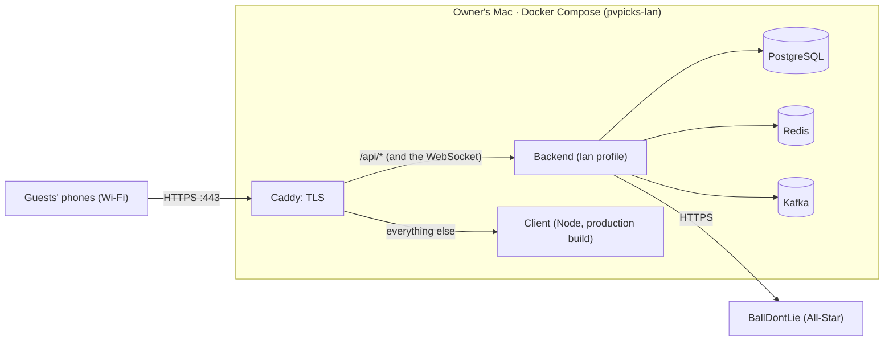

# LAN watch party

How [Milestone 1](/roadmap#milestone-1-lan-watch-party) runs: one game night,
about 5–15 guests, on home Wi-Fi. The software is built. What's left is the
owner's setup (plan, domain, certificate) and a dry run; see the
[runbook](#runbook). Decisions are the owner's, from 2026-11-15.

## Shape of the night



- Only Caddy listens on the network: 443, and 80 to redirect to it. The
  backend, client, PostgreSQL, Redis and Kafka stay on the Compose network.
- It's a separate Compose project, `pvpicks-lan` (`infra/compose/docker-compose.lan.yml`),
  with its own volumes and keys, so it never touches dev data.
- One backend instance, so the multi-instance work (one runner per scheduled
  job, a shared feed budget) isn't needed.
- Real NBA and NFL games only: the demo world, bots, DEV games and Dev page
  are off.
- In scope: U2Pick, Total Disaster, Give And Take, Either Or, Prop Hunt, King
  Of The Hill and Scorcerer (NFL).
- Data must survive the night. It can be wiped afterwards.

## HTTPS

**Decision:** a domain registered in Route 53 and a Let's Encrypt
certificate, so phones trust it with no setup. mkcert would make every guest
install and trust a certificate profile; Tailscale would make every guest
install an app.

- Register a domain in the AWS project and use its Route 53 hosted zone
  (about $0.50 a month).
- Add an A record, `p2picks.<domain>`, pointing at the Mac's LAN address.
  Reserve that address in the router's DHCP settings so it doesn't change
  mid-party.
- Get the certificate before the party with a DNS challenge, for example
  `certbot certonly --dns-route53 -d p2picks.<domain>`, using the owner's
  short-lived `aws login` session. This needs no long-lived AWS keys on the
  Mac, and the Mac never has to be reachable from the internet. Copy
  `fullchain.pem` and `privkey.pem` into `infra/caddy/certs/` (git-ignored).
  The certificate lasts 90 days.
- Caddy (`infra/caddy/Caddyfile`) serves that certificate, redirects HTTP to
  HTTPS and adds HSTS, `nosniff`, `X-Frame-Options: DENY` and
  `Referrer-Policy: no-referrer`.
- **Risk to check in the dry run:** some routers and DNS resolvers refuse
  public names that point at private addresses (DNS-rebinding protection).
  If a phone can't resolve the name, add a local DNS entry on the router.
- To try the stack on the Mac before the domain exists, set
  `PVPICKS_LAN_HOST=localhost` and `PVPICKS_LAN_TLS=internal` (Caddy's own
  certificate authority). Phones won't trust that.

## The `lan` profile

`config/DevelopmentOnlyProfile` accepts exactly one of `dev` and `lan`;
production still refuses to start. `application-lan.yml`:

| Setting | `lan` |
|---|---|
| Bind address | The Compose network only; Caddy is the way in |
| Allowed origin | `PVPICKS_ORIGIN` = `https://<PVPICKS_LAN_HOST>`, for API requests and the WebSocket. It must be HTTPS. |
| Forwarded headers | `server.forward-headers-strategy: native`: the backend trusts `X-Forwarded-*` from private-network proxies (Caddy), and Caddy replaces any the phones send. So the sign-in throttle and rate limits see each phone's address. |
| Cookies | Session and CSRF cookies are `Secure` (`pvpicks.secure-cookies`), `SameSite=Strict`, HttpOnly |
| Keys | `.env.lan.auth` and `.env.lan.idempotency`, generated by `scripts/provision-lan.sh --init`, never the dev ones |
| Off | Demo world, passwordless sign-in, `/dev/**` and the handbook (denied), dev sports data, feed recordings |
| On | Lock worker, sports resolution, outbox relay, rate limits, and the BallDontLie feed at All-Star intervals (`PT15S` scores, `PT3S` stats) |
| Database | Flyway migrates on start; no resets during the night |

The client runs as a production build, server-rendered by Node
(`client/Dockerfile.lan`, Nitro's `node-server` preset), not the Vite dev
server.

## Accounts and passwords

Implemented. Admin-issued, single-use setup codes: players choose their own
passwords, and the admin never sees one.

- **First admin.** `PVPICKS_BOOTSTRAP_ADMIN` names the admin account. On
  start, until that admin has set a password, the backend creates it if
  needed and logs a one-time setup link: a single-use, 24-hour secret, in
  the local logs only (`accounts.AdminBootstrap`).
- **Create players.** In the admin workspace, Players creates an account and
  shows its setup link, `https://<host>/setup#<code>`, with a QR code. The
  code sits in the URL fragment, so it never reaches server or proxy logs.
  It expires after 24 hours, works once, and is shown only once. Use
  `scripts/lan-players.sh` to create a list of guests at once.
- **Set up.** The player opens the link, chooses a password and is signed
  in. Until then the account has no usable password, and sign-in fails like
  a wrong password.
- **Reset.** Players gets a "Reset link" button for anyone who forgets. A
  new link cancels the old one. Using it ends all of that player's
  sessions. There's no email, so there's no self-service recovery.
- **Change.** Any signed-in account changes its password with the current
  one (Preferences → Account for players, the Account tab for admins). That
  ends its other sessions.
- **Password rules** (NIST SP 800-63B, `security.PasswordPolicy`):
  - 12 to 64 characters, and at most 72 bytes (BCrypt's limit).
  - No required character mixes.
  - Doesn't contain the username.
  - Not on the bundled common-password list
    (`security/common-passwords.txt`; extend it before production).
  - Hashing stays BCrypt-12.
- **Storage.** Codes are 128-bit random values, stored only as a SHA-256
  hash with their purpose (setup or reset), expiry, use time and issuing
  admin (`account_setup_codes`, V35). Bad codes count toward the
  per-address sign-in throttle, and wrong current passwords toward the
  account's.
- **Admin.** The owner moderates from the admin account and plays from a
  separate player account, because admins can't use player APIs.

Endpoints: `POST /auth/setup`, `POST /auth/password`, `GET`/`POST
/admin/players` and `POST /admin/players/{playerId}/code` (see the OpenAPI
file).

## Betting rules for the night

Every wash trigger for the in-scope modes is implemented and tested. The
domain rules' [wash triggers](/reference/domain-rules#wash-triggers) list
them, and Scorcerer's rules are in
[Player stats](/player-stats#scorcerer-from-team-totals).

## Runbook

The Compose command used below, from the repository root:

```sh
lan="docker compose -f infra/compose/docker-compose.lan.yml --env-file infra/compose/.env.lan"
```

**Before**

1. Buy All-Star for both leagues.
2. Register the domain, add the A record, reserve the DHCP address, and get
   the certificate into `infra/caddy/certs/`.
3. `./scripts/provision-lan.sh --init`, then fill in `infra/compose/.env.lan`:
   - `PVPICKS_LAN_HOST`
   - `PVPICKS_BOOTSTRAP_ADMIN`
   - `PVPICKS_BALLDONTLIE_API_KEY`
4. `$lan up -d --build --wait`. Open the setup link from `$lan logs backend`
   and set the admin's password.
5. Create the guests' accounts: in Players, or with
   `scripts/lan-players.sh <host> <admin> <name> …` (with `qrencode`
   installed it prints QR codes). Create your own player account too.
6. Dry run on the real Wi-Fi with at least two phones:
   - sign up from a setup link
   - propose, pick, lock and resolve a U2Pick and a sports bet
   - settle points
   - check live updates and the router DNS risk above

**During**

- Keep the Mac plugged in and awake (`caffeinate -dims`), and allow
  Docker's incoming connections in the macOS firewall.
- Watch admin site health, the ticker's feed status and `$lan logs -f backend`.
- Every service restarts on failure. Data is in PostgreSQL, so open bets
  resume, and clients refetch when they reconnect.

**After**

- Optionally save the night: `$lan exec postgres pg_dump -U p2picks p2picks > night.sql`.
- Wipe with `$lan down -v`. Revoke the BallDontLie key or change plans if it
  was only for the party.
