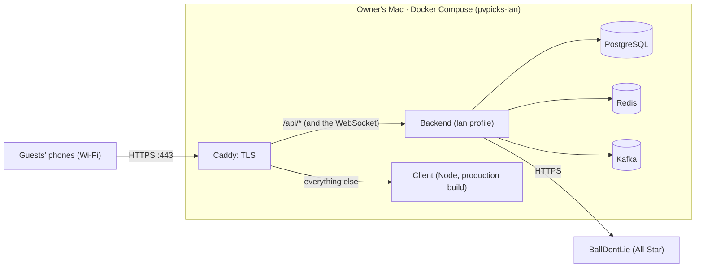

# LAN watch party

How a watch party runs ([Milestone 1](/roadmap#milestone-1-lan-watch-party),
done): one game night, about 5–15 guests, on one Wi-Fi network, served from
the host's Mac at `https://lan.p2picks.com`. Real parties have run. The root
README has the hosting steps; the [runbook](#runbook) below adds the dry
run and what to watch. Decisions are the owner's, from 2026-11-15 on.

## Shape of the night



- Only Caddy listens on the network: 443, and 80 to redirect to it. The
  backend, client, PostgreSQL, Redis and Kafka stay on the Compose network.
- It's a separate Compose project, `pvpicks-lan` (`infra/compose/docker-compose.lan.yml`),
  with its own volumes and keys, so it never touches dev data.
- One backend instance, so the multi-instance work (one runner per scheduled
  job, a shared feed budget) isn't needed.
- Real NBA and NFL games only: the demo world, bots, DEV games and Dev page
  are off.
- In scope: U2Pick, Total Disaster, Give And Take, Either Or, Prop Hunt, King
  Of The Hill, Scorcerer (NFL and NBA) and Jackblack.
- Data must survive the night. It can be wiped afterwards.

## HTTPS

**Decision:** a real domain with a Let's Encrypt certificate, so phones trust
it with no setup. mkcert would make every guest install and trust a
certificate profile; Tailscale would make every guest install an app.

- `p2picks.com` is registered on Cloudflare, which also serves its DNS
  (owner, 2026-11-21; registering in Route 53 failed on the account).
- **One fixed name**, `lan.p2picks.com`: an A record pointing at the Mac's
  address on the party's Wi-Fi, with Cloudflare's proxy **off** (DNS only),
  since the proxy can't reach a home network. At each new location, only the
  record's address changes. The certificate belongs to the name, so it, the
  guests' links and their QR codes keep working. Reserve the address in the
  router's DHCP settings so it doesn't change mid-party.
- The certificate comes from a DNS challenge before the party: certbot's
  Cloudflare plugin in Docker (`certbot/dns-cloudflare`), with an API token
  limited to editing `p2picks.com`'s DNS, saved owner-only in
  `~/.secrets/cloudflare.ini`. The Mac never has to be reachable from the
  internet. Certbot keeps its state in `~/.p2picks-letsencrypt`; the two
  files Caddy needs, `fullchain.pem` and `privkey.pem`, are copied into
  `infra/caddy/certs/` (git-ignored). It lasts 90 days; renewing is one
  command (README).
- Caddy (`infra/caddy/Caddyfile`) serves that certificate, redirects HTTP to
  HTTPS and adds HSTS, `nosniff`, `X-Frame-Options: DENY` and
  `Referrer-Policy: no-referrer`.
- **Risk to check in the dry run:** some routers and DNS resolvers refuse
  public names that point at private addresses (DNS-rebinding protection).
  If a phone can't resolve the name, add a local DNS entry on the router.
- To try the stack on the Mac before the domain exists, set
  `PVPICKS_LAN_HOST=localhost` and `PVPICKS_LAN_TLS=internal` (Caddy's own
  certificate authority). Phones won't trust that.
- To try it from phones before the domain exists, set `PVPICKS_LAN_HOST` to
  the Mac's Wi-Fi address (`ipconfig getifaddr en0`) and keep
  `PVPICKS_LAN_TLS=internal`. Each phone has to tap through a certificate
  warning. Browsers send no server name for an IP address, so the Caddyfile's
  `default_sni` picks the certificate.

## The `lan` profile

The backend runs in one of three modes, `common.AppMode` (shared, so security can use it): **dev**, **lan**
or **prod**. It reads the mode from its one Spring profile, and refuses to
start with anything but exactly one of `dev` and `lan` (production isn't
configured yet). The client asks `GET /config` (`{"mode": "lan"}`, signed in
or out) to pick its sign-in. See
[the three modes](/architecture#three-modes-dev-lan-prod) for how code is
split between them. `application-lan.yml`:

| Setting | `lan` |
|---|---|
| Bind address | The Compose network only; Caddy is the way in |
| Allowed origin | `PVPICKS_ORIGIN` = `https://<PVPICKS_LAN_HOST>`, for API requests and the WebSocket. It must be HTTPS. |
| Forwarded headers | `server.forward-headers-strategy: native`: the backend trusts `X-Forwarded-*` from private-network proxies (Caddy), and Caddy replaces any the phones send. **But** Docker Desktop on a Mac hands Caddy every connection from one address (`192.168.65.1`, checked 2026-11-18), so per-address limits are party-wide. That's why wrong sign-in codes count per player, not per address (see Throttle below); signed-out requests share 120 writes a minute, far more than sign-in needs. |
| Cookies | Session and CSRF cookies are `Secure` (`pvpicks.secure-cookies`), `SameSite=Strict`, HttpOnly |
| Keys | `.env.lan.auth` and `.env.lan.idempotency`, generated by `scripts/provision-lan.sh --init`, never the dev ones |
| Off | Demo world, passwordless sign-in, `/dev/**` (denied), dev sports data, feed recordings |
| Admin only | The handbook at `/docs/` (Caddy routes it to the backend; anyone without an admin session is sent to `/admin`), linked from the admin portal |
| On | Lock worker, sports resolution, outbox relay, rate limits, the BallDontLie feed at All-Star intervals (`PT15S` scores, `PT3S` stats), and the [party table](#the-party-table) (`pvpicks.lan.party.enabled`) |
| Database | Flyway migrates on start; no resets during the night |

The client runs as a production build, server-rendered by Node
(`client/Dockerfile.lan`, Nitro's `node-server` preset), not the Vite dev
server.

## Accounts and sign-in codes

Implemented (owner decision, 2026-11-17). Players have no passwords: each
has a short sign-in code, and gets in by scanning their QR code or typing
the code. Only the admin has a password.

- **The admin.** `PVPICKS_BOOTSTRAP_ADMIN` names the one admin account and
  `PVPICKS_BOOTSTRAP_ADMIN_PASSWORD` sets its password (the "special
  password" for the admin portal; it must pass the password rules below).
  The backend creates the admin on start; the password is set only while
  the admin has none, so a password changed later in the app survives
  restarts (`accounts.AdminBootstrap`). The admin signs in at
  `https://<host>/admin`, which nothing links to (owner decision,
  2026-11-18): guests only ever see the code sign-in. The same page works in
  dev.
- **Create players.** Users → New player (or `scripts/lan-players.sh` for a
  list of guests) creates an account with its sign-in code, and seats it at
  the [party table](#the-party-table).
- **Delete players.** **Delete account** on a player's card, after a
  warning, deletes them outright, even with open bets: those bets wash for
  everyone at those tables (see
  [Admin account deletion](/reference/domain-rules#admin-account-deletion)).
  Their username becomes free, so a typo can be recreated.
- **Codes.** 4 characters from `ABCDEFGHJKMNPQRSTUVWXYZ23456789` (no
  look-alikes), case, spaces and dashes ignored. A code stays the same until
  the admin rotates it. The QR link is
  `https://<host>/signin#<playerId>.<code>`: the player's id, not their
  username, so renaming yourself in Preferences doesn't break a photographed
  QR. It sits in the URL fragment, so it never reaches server or proxy logs.
- **Signing in.** The sign-in page asks for the username and code (the
  username trimmed and case-insensitive), or the player scans their QR code,
  which opens the link and signs them in at once (signed in or out: scanning
  another player's code switches to that account). After a rename, typed
  sign-in uses the new username.
- **Showing a code.** Each player's card in Users holds their QR code and
  code, blurred until the admin presses **Show** on the QR (the real code
  only reaches the browser then). One code is shown at a time, showing it
  also opens that player's audit, and tapping the shown QR blurs it again.
  Players can photograph it to get back in later. Players never see their
  own code in the app; only the admin does.
- **Rotating.** **Rotate** on the card (after a confirmation) issues a new
  code and signs the player out on every device, so an old photo stops
  working; the player scans or types the new one, even on the same phone.
  Use it when a code is lost or seen by someone else.
- **Throttle.** Owner decision (2026-11-18): wrong codes count **per
  player**. Ten wrong codes against one player
  (`PVPICKS_LOGIN_THROTTLE_CODES_PER_PLAYER`) lock that player, QR
  included, for 15 minutes; nobody else is affected. The count follows the
  player's id, so a rename doesn't reset it, and a username that matches
  nobody gets its own count. An unknown username and a wrong code get the
  same answer, so sign-in doesn't reveal who exists. A backstop of 100 wrong
  codes per address (`PVPICKS_LOGIN_THROTTLE_CODES_PER_ADDRESS`) stops
  spraying many usernames; behind Docker Desktop every phone shares one
  address, so that one is party-wide and set high enough that honest typos
  never reach it. Because a guess must match the named player's own code,
  10 tries per 15 minutes leaves a guesser centuries from a code.
- **Lockouts.** Anyone who knows a username can lock that player out. The
  admin sees locked players as a red banner on Users and a **Locked out**
  chip on their card, each with **Unlock**; Perf shows the counts and
  **Clear all** (`GET`/`DELETE /admin/sign-in-lockout`, `DELETE
  /admin/sign-in-lockout/players/{playerId}`).
- **Storage.** `sign_in_codes` (V41) keeps an HMAC of each code for lookup
  and an AES-GCM encrypted copy for the admin's view; both keys derive from
  the session signing key (`.env.lan.auth`), so a database copy alone
  reveals no codes. Changing that key makes every code unreadable, and the
  backend then issues every player a new one on start.
- **Admin password rules** (NIST SP 800-63B, `security.PasswordPolicy`):
  12 to 64 characters and at most 72 bytes (BCrypt's limit), no required
  character mixes, not containing the username, not on the bundled
  common-password list (`security/common-passwords.txt`); hashed with
  BCrypt-12. The admin changes it from the sidebar.
- **Playing.** The owner moderates from the admin account and plays from a
  separate player account, because admins can't use player APIs.

Endpoints: `GET /config`, `POST /auth/code`, `POST /auth/login` (admin),
`POST /auth/password` (admin), `GET`/`POST /admin/players`, `DELETE
/admin/players/{playerId}`, `GET`/`POST /admin/players/{playerId}/code` and
`GET /admin/lan/party` (see the OpenAPI file).

## The party table

Owner decisions, 2026-11-18. Guests shouldn't have to set up a table or add
each other as friends, so the server does it (`lan.PartyTable`, LAN only):

- The **first player** the admin creates gets a table named **New Table**
  (🏈) and is its only host. Create your own player account first, then
  rename the table from it.
- **Every later player** is seated there directly as a member, ignoring
  invite settings (no invitation to accept), and follows and is followed by
  everyone already at it, so they're all friends. It happens in the same
  transaction as creating the player.
- If the table is **deleted** (by its host, or because every player at it
  was deleted while testing), the next player created hosts a fresh "New
  Table" and later players join that one. Players created in between keep
  no table.
- The admin's Users tab shows the table above the player cards (its name
  and size, or that it doesn't exist yet or was deleted) and **Host** / **At
  the table** chips on the cards (`GET /admin/lan/party`).
- `lan_party` (V43) records the table: one row, written by the first
  player and pointed at the new table if it is replaced.

How it's wired: `accounts.PlayerProvisioning` publishes `PlayerCreated`
inside its transaction, and `lan.PartyTable` listens. It creates and seats
through the tables module's `TableProvisioning` and befriends through the
social module's `Friendships`, the same rows, realtime events and chat lines
as a player's own actions. Nothing outside `lan` knows the party exists.

## Betting rules for the night

Every wash trigger for the in-scope modes is implemented and tested. The
domain rules' [wash triggers](/reference/domain-rules#wash-triggers) list
them, and Scorcerer's rules are in
[Player stats](/player-stats#scorcerer-from-team-totals).

## Runbook

The Compose command used below, from the repository root:

```sh
alias lan="docker compose -f infra/compose/docker-compose.lan.yml --env-file infra/compose/.env.lan"
```

**Before**

1. BallDontLie All-Star for both leagues (bought).
2. Point `lan.p2picks.com` at the Mac, reserve the address in the router, and
   have a current certificate in `infra/caddy/certs/` (README, "Host a LAN
   party").
3. `./scripts/provision-lan.sh --init` (first time on a Mac), then fill in
   `infra/compose/.env.lan`:
   - `PVPICKS_LAN_HOST`
   - `PVPICKS_BOOTSTRAP_ADMIN` and `PVPICKS_BOOTSTRAP_ADMIN_PASSWORD`
   - `PVPICKS_BALLDONTLIE_API_KEY` (without it the app runs, but there are
     no live scores, so sports bets can't resolve)

   A `.env.lan` made before 2026-11-17 has no
   `PVPICKS_BOOTSTRAP_ADMIN_PASSWORD` line: add it, or Compose refuses to
   start. Optionally, try the stack on the Mac first with
   `PVPICKS_LAN_HOST=localhost` and `PVPICKS_LAN_TLS=internal` (see
   [HTTPS](#https)), then `lan down -v` before the real run.
4. `lan up -d --build --wait`, then sign in at `https://<host>/admin`.
5. Create **your own player account first**: it hosts the party table. Sign
   in to it on your phone and rename New Table. Then create the guests' accounts:
   in Users, or with `scripts/lan-players.sh <host> <admin> <name> …` (with
   `qrencode` installed it prints QR codes). Each one is seated at your table
   as everyone's friend.
6. At a new location or after changes, dry run on the real Wi-Fi with at
   least two phones:
   - scan a player's QR code from the admin's Users tab, and type a code
   - rotate a code, check the phone is signed out, then sign it back in
     with the new code
   - type ten wrong codes for one player, check their card shows **Locked
     out** and another player still signs in, then **Unlock** them
   - rename a player in Preferences and check their QR photo still works
   - check a new player lands at the party table, friends with everyone
   - delete a test player who's in an open bet; check the bet washed
   - propose, pick, lock and resolve a U2Pick and a sports bet
   - settle points
   - check live updates and the router DNS risk above

**During**

- Keep the Mac plugged in and awake (`caffeinate -dims`), and allow
  Docker's incoming connections in the macOS firewall.
- Watch the admin Perf tab (dependencies, feeds, sign-in codes, slow or
  failing routes), the ticker's feed status and `lan logs -f backend`.
- If a guest says their code or QR "stopped working", look for the red
  lockout banner on Users (or **Locked out** on their card) and press
  **Unlock**.
- Every service restarts on failure. Data is in PostgreSQL, so open bets
  resume, and clients refetch when they reconnect.

**After**

- Optionally save the night: `lan exec postgres pg_dump -U p2picks p2picks > night.sql`.
- Wipe with `lan down -v`.
